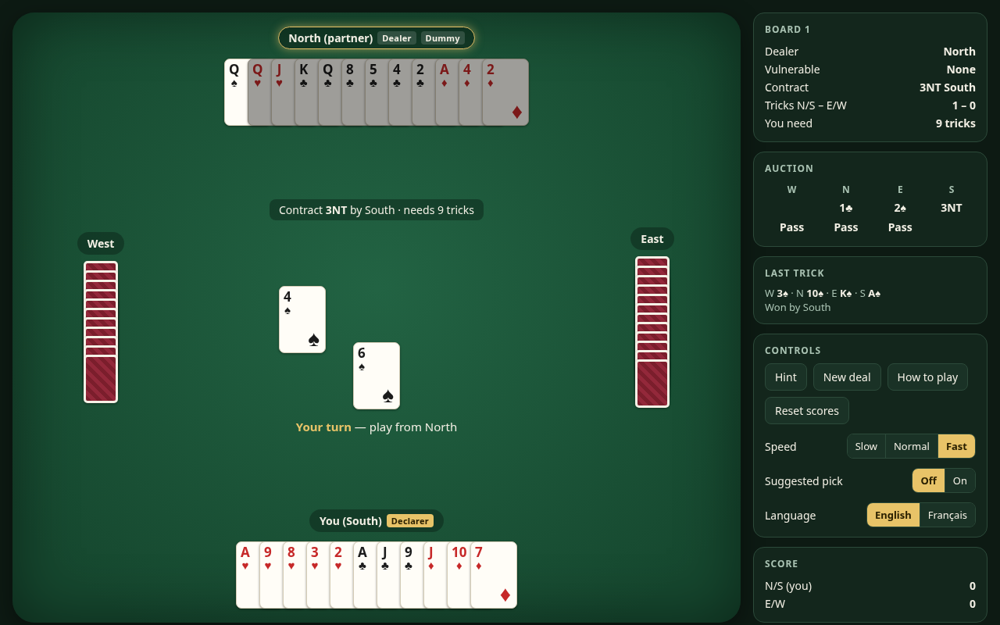
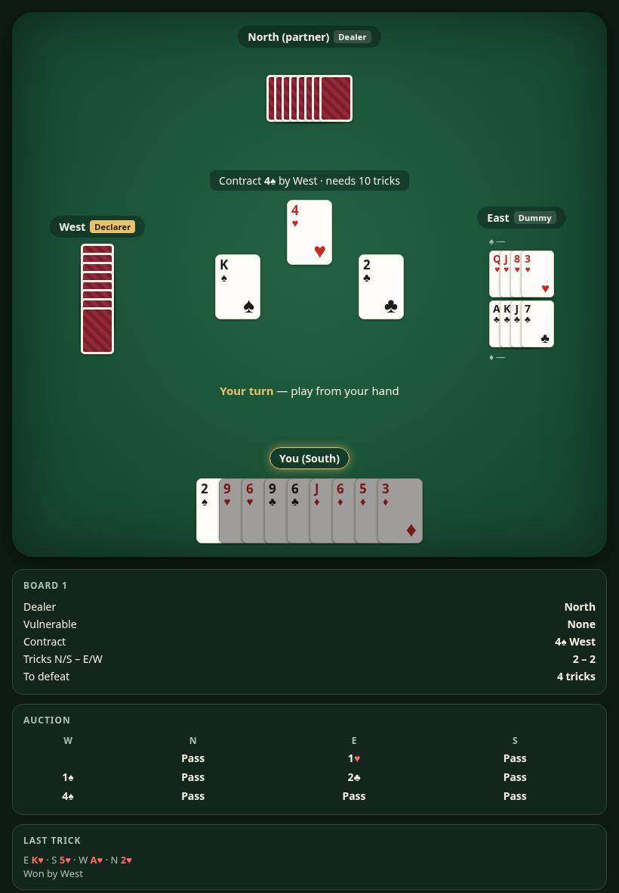
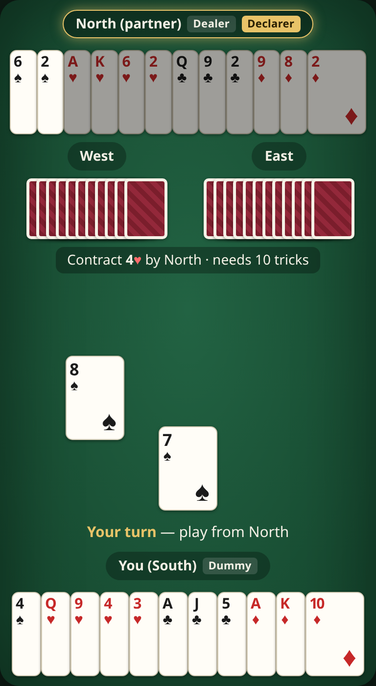
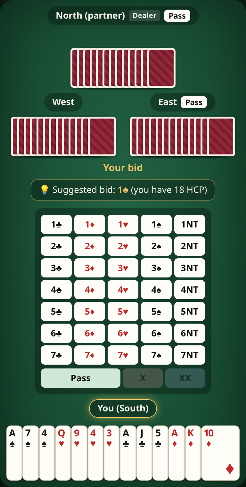

# Bridge

A simple game of contract bridge against the computer, which I made for my grandma so she can play
anytime, even without internet. You play South; the computer plays your partner and both opponents.

**▶ Play it here: [thermovr.github.io/bridge](https://thermovr.github.io/bridge/)**

It fits any screen: computer, tablet or phone.

| Tablet | Phone: playing | Phone: bidding |
|:---:|:---:|:---:|
|  |  |  |

> **About this project.** Most of the code was written with AI assistance. I don't plan to keep it updated
> beyond what my grandma needs, but suggestions and bug reports are welcome in [Issues](../../issues).

## Put it on your home screen

Once it's on your home screen it opens like a normal app and **works offline**.

- **iPhone / iPad (Safari):** open the link, tap **Share**, then **Add to Home Screen**.
- **Android (Chrome):** open the link, tap the **⋮** menu, then **Add to Home screen** (or **Install app**).
- **Computer (Chrome / Edge):** click the install icon in the address bar, or just bookmark the page.

Open it once while online, and from then on it plays without internet. When you're online it quietly picks
up any updates.

## Features

- **Full contract bridge:** bidding, declaring and defending. When your side declares, you also play
  partner's hand (the dummy).
- **Hints:** tap **Hint**, or switch on **Suggested pick**, for advice on what to bid or play, with a short
  explanation ("Second hand low", "Draw trumps", and so on).
- **Hints that look ahead:** during play, the advice imagines dozens of ways the hidden cards could lie,
  plays each one out to the end, and recommends the card that works most often.
- **Adjustable speed:** slow the computer players down if things happen too fast.
- **English and French**, switchable at any time.
- **Score keeping:** duplicate-style scores, vulnerability rotating by board, and a history of recent deals.
- **Replay a deal** to try it again differently, or abandon one and deal a new hand.
- **Private:** no account, no ads, nothing sent anywhere. Scores are saved on your own device.

## How to play (the short version)

1. **Bid** with the bidding box. Each bid must be higher than the last (♣ < ♦ < ♥ < ♠ < NT). Three passes
   in a row end the auction.
2. A bid of **n** promises **6 + n** tricks. Game is 3NT, 4♥ / 4♠, or 5♣ / 5♦.
3. **Play** the cards: follow suit if you can; the highest card of the suit led wins the trick, unless
   someone plays a trump.

The **How to play** button in the game explains everything in more detail.

**The computer's bidding** is simple and natural: 1-level openings with 12+ points, 5-card majors,
1NT = 15–17 balanced, 2NT = 20–21, weak two-level openings, 5+ card overcalls, takeout doubles. It doesn't
use conventions like Stayman, transfers or Blackwood, so keep your own bids natural too.

## Files

| File | What it is |
|---|---|
| `index.html` | The whole game: layout, bidding, play, hints and scoring |
| `sw.js` | Keeps a copy of the game on your device so it works offline |
| `manifest.webmanifest`, `icon-*.png` | Name and icons for the home-screen app |

No build step: any static web host works, and this one is served straight from the repo by GitHub Pages.

♠ ♥ ♦ ♣

Love you, Grandma! ♥

## License

MIT. See [LICENSE](LICENSE).
